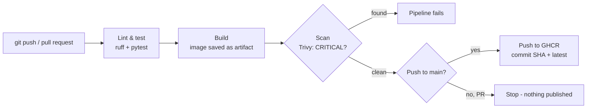

# Shuttle Booking Platform


A booking API for a staff shuttle business, used as the base for a hands-on DevOps
platform: containerised, tested, scanned and shipped automatically by a CI pipeline.

> **Week 1 of 5** - Containers & CI. Coming next: Terraform on Azure, Kubernetes (AKS)
> with GitOps, monitoring, and DevSecOps.

## Pipeline




## What's in it

| Area | What I did | Why |
|---|---|---|
| Container | Multi-stage Dockerfile on `python:3.12-slim` | Smaller image, fewer vulnerabilities |
| Security | Runs as non-root user (UID 10001) | Limits damage if the app is compromised |
| Image size | `python:3.12` base: **1.62 GB** (430 MB download) -> final image: **307 MB** (72.7 MB download), ~81% smaller | Faster pulls, smaller attack surface |
| Local stack | docker-compose with PostgreSQL, healthcheck and named volume | Data survives restarts; API waits for DB |
| CI | GitHub Actions: lint -> test -> build -> scan -> push | Every change verified automatically |
| Traceability | Images tagged with the Git commit SHA; `/health` reports it | Always know exactly what code is running |
| Supply chain | Trivy scan blocks CRITICAL vulnerabilities; Trivy action pinned to a commit SHA | Defence against tag-hijacking attacks like the March 2026 trivy-action compromise |
| Governance | Branch protection: no direct pushes to `main`, checks must pass | Same workflow as a real team |

## Run it locally

```powershell
docker compose up --build -d
# open http://localhost:8000/docs
docker compose down
```

## API

| Method | Path | Purpose |
|---|---|---|
| GET | `/health` | Liveness check + running version |
| GET | `/trips` | List trips |
| GET | `/trips/{id}` | Get one trip |
| POST | `/trips` | Book a trip (1-14 passengers) |

## What I learned

The pipeline event always tell a story if you know how to read them.
