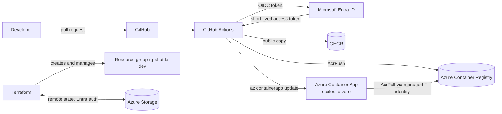
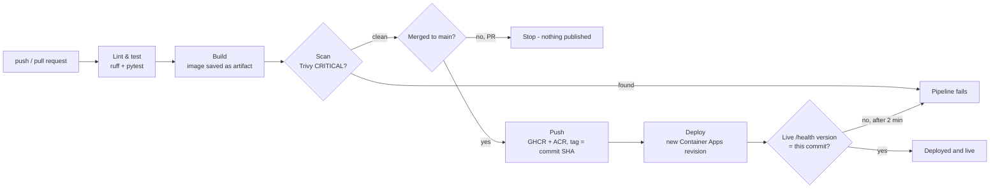

# Shuttle Booking Platform


A booking API for a staff shuttle business, used as the base for a hands-on DevOps
platform. Every change is tested, built into a container, scanned, and - once merged
to `main` - deployed to **Azure Container Apps** automatically, with **no stored
cloud credentials**. All Azure infrastructure is defined in **Terraform**.

## Architecture



## Pipeline



## What's in it

| Area | What I did | Why |
|---|---|---|
| Container | Multi-stage Dockerfile on `python:3.12-slim`, non-root user (UID 10001), healthcheck | Smaller image, smaller attack surface |
| Image size | `python:3.12` base 1.62 GB -> final image 307 MB (~81% smaller) | Faster pulls and cold starts |
| CI | GitHub Actions: lint -> test -> build -> scan -> push -> deploy, as separate jobs | Each stage visible; the exact scanned image is what gets shipped |
| Supply chain | Trivy blocks CRITICAL vulnerabilities; Trivy action pinned to a commit SHA | Tags can be hijacked (as in the March 2026 trivy-action attack); SHAs can't |
| Infrastructure as code | Terraform for the resource group, ACR, Log Analytics, Container Apps environment and app; remote state in Azure Storage with Entra ID auth; provider versions pinned | Repeatable environments, no state on a laptop, no storage keys |
| Identity | GitHub signs in to Azure with **OIDC workload identity federation**, trusting only `main` (immutable subject with owner and repo IDs) | No client secret to leak, expire or rotate; pull requests can't reach Azure |
| Least privilege | Pipeline: AcrPush on the registry + Contributor on one resource group. App: AcrPull via managed identity. Per-job workflow permissions | A compromised component can only affect its own small scope |
| Deployment | Container Apps revisions, scale to zero, startup/readiness/liveness probes with explicit timings | New version only takes traffic when healthy; near-zero idle cost |
| Verification | Deploy job polls the live `/health` until it reports this commit's SHA | "Green" means the new version is actually serving, not just that a command ran |
| Reproducibility | Role assignments managed in Terraform (imported); pipeline discovers the registry at runtime | `terraform destroy` + `apply` rebuilds everything with no manual steps |
| Drift control | `terraform plan` kept at "No changes"; documented `ignore_changes` only where the pipeline owns a value | A plan that always shows changes gets ignored |
| Governance | Branch protection: pull requests and passing checks required, no direct pushes to `main` | Same workflow as a real team |

## Repository layout

```text
.
├── main.py                  # FastAPI app
├── tests/                   # pytest tests
├── Dockerfile               # multi-stage, non-root image
├── docker-compose.yml       # local stack: API + PostgreSQL
├── infra/                   # Terraform for Azure
└── .github/workflows/ci.yml # CI/CD pipeline
```

## Run it locally

```powershell
docker compose up --build -d
# open http://localhost:8000/docs
docker compose down
```

## Deploy the infrastructure

```powershell
cd infra
az login
$env:ARM_SUBSCRIPTION_ID = az account show --query id -o tsv
terraform init
terraform plan -out tfplan
terraform apply tfplan
```

Application deploys after that are done by the pipeline on every merge to `main`.

## API

| Method | Path | Purpose |
|---|---|---|
| GET | `/health` | Liveness check + running version (commit SHA) |
| GET | `/trips` | List trips |
| GET | `/trips/{id}` | Get one trip |
| POST | `/trips` | Book a trip (1-14 passengers) |

## What I learned


The pipeline event always tell a story if you know how to read them.
If it belongs to the infrastructure, it belongs to Terraform state file. Having infrascture that is not declared in Terraform caused headache when you run Terraform destroy and Teraform apply - Terraform will only build what is declared/imported into state file.
